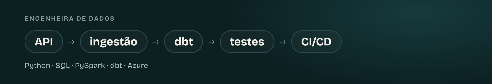

  
  
  
  
  

Construo pipelines que levam o dado da fonte até a camada analítica, com arquitetura em camadas, modelagem dimensional, testes automatizados, CI/CD e documentação técnica.

Antes dos dados, trabalhei com engenharia civil e operações financeiras. Dessa trajetória veio o hábito de conferir se os números fecham.

## Projeto atual

### [Monitor Parlamentar](https://github.com/nadinne94/monitor-parlamentar)

Pipeline que acompanha, mês a mês, a atuação dos deputados federais de Minas Gerais a partir da API de Dados Abertos da Câmara: proposições, votos nominais, presença e cota parlamentar.

- Ingestão em Python com validação em Pydantic e retentativas para uma API instável
- Transformação em dbt sobre DuckDB, com contrato de dados nos marts
- Testes automatizados e CI/CD no GitHub Actions: cada merge executa o pipeline e publica o site
- Entregas em versões incrementais, com as decisões técnicas registradas em ADRs

[Código](https://github.com/nadinne94/monitor-parlamentar) · [Site no ar](https://nadinne94.github.io/monitor-parlamentar/) · [Página no portfólio](https://nadinne94.github.io/portfolio/projetos/monitor-parlamentar/)

## Outros projetos

| Projeto | O que é | Stack |
| --- | --- | --- |
| [Pipeline Legislativo](https://github.com/nadinne94/pipeline-legislativo) | Plataforma Lakehouse com dados abertos da Câmara, das camadas Bronze a Serving, com Star Schema e Power BI | PySpark, Delta Lake, Databricks, MLflow |
| [Azure End-to-End](https://github.com/nadinne94/azure-end-to-end-data-engineer-project) | Pipeline em cloud com orquestração no Data Factory e Data Warehouse no Synapse | Data Factory, ADLS Gen2, Synapse |
| [Pipeline AdventureWorks](https://github.com/nadinne94/pipeline_adventureworks) | Pipeline em camadas Bronze, Silver e Gold com modelagem dimensional | PySpark, Delta Lake, SQL |

## Stack

- **Linguagens:** Python, SQL, PySpark, pandas
- **Transformação e modelagem:** dbt, DuckDB, Delta Lake, modelagem dimensional
- **Qualidade e DataOps:** pytest, testes do dbt, contratos de dados, Pydantic
- **Cloud e orquestração:** Azure (Data Factory, ADLS Gen2, Synapse), Databricks, GitHub Actions
- **Bancos de dados:** PostgreSQL, SQL Server, MySQL
- **BI:** Power BI, DAX, Power Query

## Formação

Tecnóloga em Análise e Desenvolvimento de Sistemas (UNICV, 2026) · Engenheira Civil (UFVJM, 2018)
